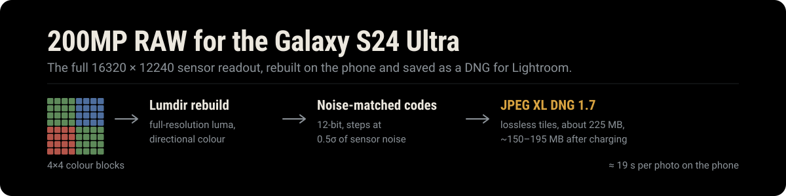
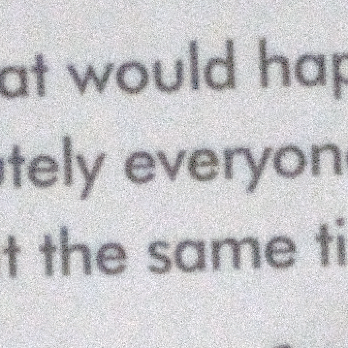
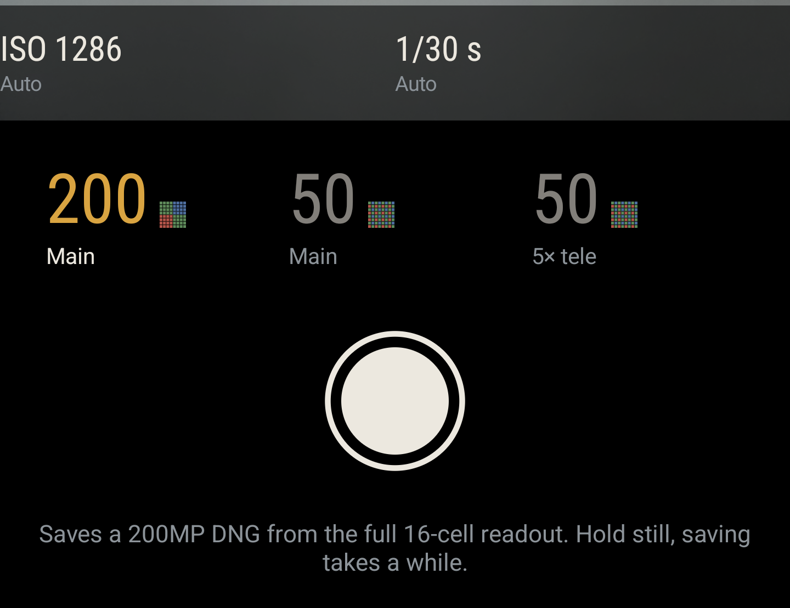

<p align="center">
  
</p>

# S24 Ultra 200MP RAW — full-resolution DNG camera for the Galaxy S24 Ultra

An open-source Android camera app that captures the **full 200-megapixel RAW**
readout of the Samsung Galaxy S24 Ultra's main sensor (ISOCELL HP2,
16320 × 12240), reconstructs it on the phone, and saves a **lossless DNG you can
edit in Adobe Lightroom**.

Samsung's own camera only gives you 200MP as a processed JPEG, and Expert RAW
stops at 50MP. This app reaches the hidden 200MP RAW stream, rebuilds full
resolution from the sensor's 4×4 colour blocks, and writes a linear DNG
compressed with lossless JPEG XL.

<p align="center">
  
  &nbsp;
  
</p>
<p align="center"><sub>Left: 2× crop of small print from a 200MP DNG. Right: the camera screen.</sub></p>

## Features

- **200MP RAW → DNG.** The full 16320 × 12240 readout from the main camera, not an
  upscaled 50MP image.
- **Lumdir reconstruction.** The HP2 has a 16-cell ("Tetra²pixel") colour filter: 4×4
  blocks of one colour, not a Bayer pattern. Lumdir rebuilds full-resolution
  luminance with directional, guided regressions, then adds colour from local
  ratios. It came out best of the reconstructions compared in [`bench/algos`](bench/algos).
- **Lightroom-ready DNG 1.7.** Linear RGB DNG with lossless JPEG XL tiles, colour
  matrix, white balance and exposure metadata, and an embedded preview.
- **Small files with no visible loss.** Samples are stored as 12-bit codes on a
  curve matched to the sensor's noise (steps at 0.5σ), so file size goes on image
  detail instead of noise. A 200MP DNG is about 225 MB.
- **Background re-compression.** While the phone charges, the app re-encodes its
  own DNGs with a slower, tuned JPEG XL profile (about 30% smaller). It checks every
  tile decodes bit-identical twice before replacing the original, with a
  crash-safe journal.
- **Fast on the phone.** About 19 s per 200MP photo on a Snapdragon 8 Gen 3,
  using native C++ kernels that match the Java reference bit for bit.
- **Manual ISO and shutter speed.** Drag the dials over the viewfinder in third
  stops, or leave either on auto.
- **50MP modes too.** 50MP main and 50MP 5× telephoto RAW, as DNG.

## Requirements

| | |
|---|---|
| Phone | Samsung Galaxy S24 Ultra (tested on SM-S928B, One UI 9 / Android 17). No root, locked bootloader is fine |
| Build machine | Windows, macOS or Linux with JDK 17+, Android SDK platform 36, NDK `30.0.16248370`, CMake `4.1.2` |
| Editing | Adobe Lightroom / Camera Raw with JPEG XL DNG support (DNG 1.7, 2023 or newer) |
| Storage | About 225 MB per 200MP photo; the app wants about 780 MB free before a shot |

## Build and install

```bash
git clone --recursive https://github.com/AbhiramJayasankar/s24-ultra-200mp-raw.git
cd s24-ultra-200mp-raw
```

If you cloned without `--recursive`, fetch libjxl (v0.11.1, used as a submodule):

```bash
git submodule update --init --recursive
```

Point Gradle at your Android SDK, either with `ANDROID_HOME` or a
`local.properties` file in the repository root:

```properties
sdk.dir=/path/to/Android/Sdk
```

Build the release APK and install it over USB (USB debugging on):

```bash
./gradlew assembleRelease
adb install -r app/build/outputs/apk/release/app-release.apk
```

On Windows use `gradlew.bat`. Use the **release** build: the debug build runs
the native encoder several times slower. Release is signed with your local debug
key, so it installs without extra setup.

> **Why the package name is `com.samsung.android.ruler`.** Samsung's camera service
> only opens the hidden camera IDs (including the 200MP RAW stream) for an
> allowlist of package names. This app uses one from that list. Install it only on
> a phone that does not have an app with that package name. See
> [`docs/FINDINGS.md`](docs/FINDINGS.md) for how each gate is passed.

## Using the app

1. Open **S24 HighRes** and allow camera access.
2. Pick **200 Main**, **50 Main** or **50 5× tele**.
3. Hold still and press the shutter. A 200MP DNG takes about 19 s to save; the
   viewfinder pauses while it saves and the ring shows progress.
4. Find the photos in `Pictures/S24 HighRes` and open them in Lightroom.

**Exposure (200MP).** The app meters the viewfinder itself. Drag the **ISO** or
**shutter** dial sideways to set it manually in third stops (right is brighter);
tap a dial to switch between Auto and Manual. With one dial on manual, the meter
sets the other.

**Background compression.** Leave the phone charging and the app shrinks its
DNGs in the background. It skips files that are still being written and stops
when the phone gets warm.

## How it works

```
Sensor (ISOCELL HP2, 16-cell)
  └─ RAW10 16320×12240 readout via Samsung vendor keys (camera id 20)
      └─ Lumdir reconstruction (Java + native C++, banded, 8 threads)
          ├─ coarse directional interpolation → luminance guide
          ├─ guided regressions + bilateral → full-resolution luminance
          └─ phase-median colour ratios → linear RGB
      └─ noise-matched 12-bit codes + DNG LinearizationTable
      └─ 256×256 tiles, lossless JPEG XL (libjxl 0.11.1, effort 1 at shot time)
          └─ LinearRaw DNG 1.7 → MediaStore (Pictures/S24 HighRes)
  └─ later, while charging: re-encode at tuned effort 7, verify, replace
```

| Stage | Time on the phone (200MP) |
|---|---|
| Reconstruction + DNG write, viewfinder paused | about 19 s |
| Same pipeline on a fixed RAW frame (benchmark) | 13.4 s, 90 CPU-seconds |
| Background re-compression while charging | about 1 min per photo |

| File size (200MP) | Size |
|---|---|
| At shot time | about 220–235 MB |
| After background re-compression | about 150–195 MB |

The design notes and measurements behind these numbers are in
[`bench/notes`](bench/notes) and [`docs`](docs).

## Repository layout

| Path | What is there |
|---|---|
| `app/src/main/java/dev/s24cam` | Camera app: `CameraActivity`, `HighResCamera`, `DngSaver`, background `CompactJobService` |
| `app/src/main/java/dev/s24cam/dng` | Reconstruction (`Lumdir16`, `Directional16`), DNG writer, JPEG XL compactor |
| `app/src/main/cpp` | Native kernels (`libs24lumdir`) and the JPEG XL bridge (`libs24jxl`) |
| `bench` | Python reference implementations, golden tests, benchmarks |
| `docs` | Findings on Samsung's camera stack and native build notes |
| `tools` | adb probe scripts and host-side verification tools |
| `third_party/libjxl` | libjxl v0.11.1 (submodule) |

## Tests

```bash
./gradlew testDebugUnitTest            # Java reference implementation
python -m unittest bench.test_lumdir    # Python reference and goldens (numpy, scipy)
```

On Windows you can also check the native kernels against Java on the host:
run `toolsuild-lumdir-host.cmd` (Visual Studio 2022), then
`gradlew.bat testDebugUnitTest -PlumdirNativeTests`.

The native kernels are compiled with strict IEEE flags
(`-ffp-contract=off -fno-fast-math`), so the C++ and Java paths produce
identical output.

## Limitations

- Only tested on the Galaxy S24 Ultra (SM-S928B). Other Samsung phones with
  200MP sensors use different camera IDs and vendor keys.
- No JPEG output: asking the camera for 200MP JPEG crashes Samsung's camera HAL,
  so the app saves RAW only.
- DNG orientation assumes the phone is held upright.
- The 50MP modes use the phone's own auto exposure; manual dials are 200MP only.

## Credits

- [libjxl](https://github.com/libjxl/libjxl) for JPEG XL encoding and decoding.
- [HyperRamzey/fold5-camera2-research](https://github.com/HyperRamzey/fold5-camera2-research)
  and [tomppi/fold5-lineageos-50mp](https://github.com/tomppi/fold5-lineageos-50mp)
  for the groundwork on Samsung's hidden camera IDs and stream options.

## License

[MIT](LICENSE). Not affiliated with or endorsed by Samsung or Adobe. "Galaxy",
"ISOCELL" and "Lightroom" are trademarks of their owners.
